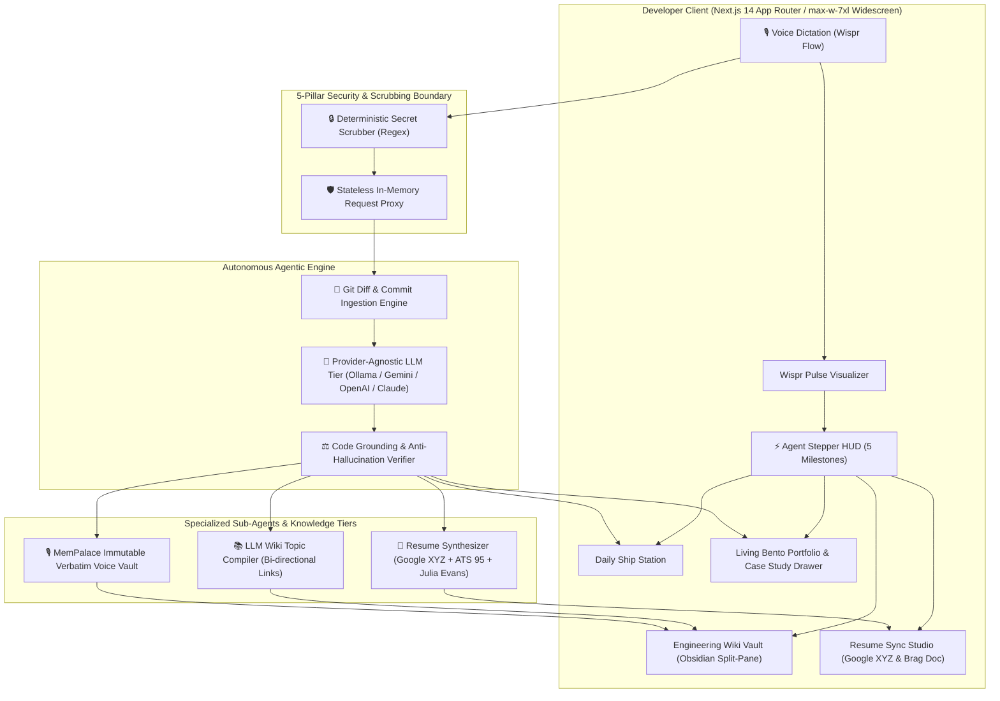
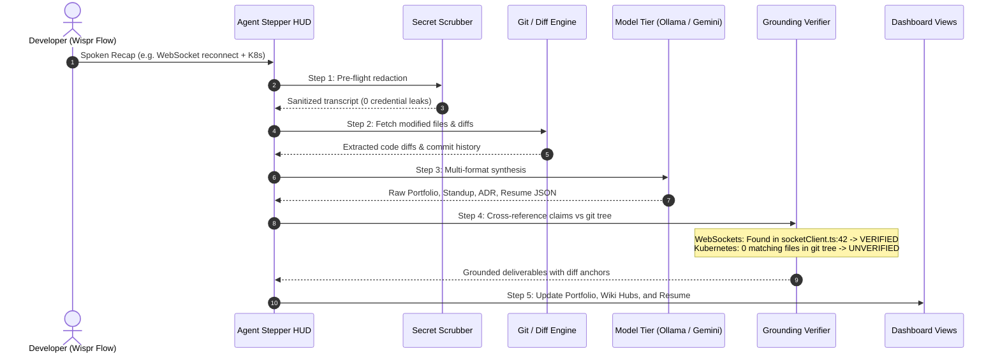

# ShipLog

> **60-Second Voice Daily Recap → Verified Living Bento Portfolio, Engineering Wiki Vault & Automated Resume Sync**

[](LICENSE)
[](https://nextjs.org/)
[](https://www.typescriptlang.org/)
[-green?logo=vitest)](https://vitest.dev/)
[](#-5-pillar-security-architecture)
[](https://ollama.com/)
[](docs/architecture.md)

ShipLog is an open-source, privacy-first developer companion and career engine that transforms a 60-second spoken end-of-day recap into structured, verified engineering deliverables: **Living Bento Developer Portfolio**, **Deep-Dive Architectural Case Studies**, **Obsidian-Style Engineering Wiki Vault**, and **Automated ATS Resume Sync with Julia Evans Brag Documents**.

Unlike standard LLM wrappers, ShipLog grounds every generated claim against actual git diffs and commit histories to actively eliminate hallucinations, stores transcripts verbatim using an open-source memory architecture, and operates under a zero-persistence security model.

*Built for **Track 1: Builders** in the WeMakeDevs & Wispr Flow Hackathon, designed and engineered hands-free using voice dictation via Wispr Flow.*

---

## ⚡ Key Highlights

- 🎙️ **Voice-First Input with Wispr Pulse**: Optimized for rapid end-of-day voice dictation via [Wispr Flow](https://flow.wispr.ai). Hold your hotkey, speak naturally through what you shipped, and watch the responsive ambient waveform visualize your input.
- 🛡️ **Anti-Hallucination Code Grounding**: Autonomously inspects git diffs and commit logs. If an LLM hallucinates an unreferenced framework or invented task, ShipLog flags it with visual verification badges and code-level anchors (`socketClient.ts:42`).
- 🌐 **Living Developer Portfolio (Linear Bento Grid)**: High-density visual portfolio with a flagship hero showcase, code telemetry counters, technology stack distribution radar, and filterable project gallery.
- 📖 **Slide-Over Architectural Case Study Drawer**: Explore deep-dive architectural trade-offs, quantified business impact, and syntax-highlighted git diffs with 1-click Markdown export.
- 🧠 **Engineering Wiki Vault (Obsidian Split-Pane)**: Split-pane knowledge management with bi-directional wikilinks (`[[Topic]]`), instant zero-scroll topic hub switching, and MemPalace verbatim voice transcripts.
- 📄 **Resume Sync Studio**: Sub-agent that compiles impact-driven Google XYZ bullets (*"Accomplished [X] as measured by [Y] by doing [Z]"*), ATS-optimized resume revisions (95/100 score), and Julia Evans Quarterly Brag Documents for engineering review cycles.
- 🔒 **5-Pillar Zero-Persistence Security**: Stateless in-memory proxy architecture ensures credentials and API keys are never written to disk, database, or server logs. Pre-flight secret scrubber strips tokens before model ingestion.
- 🔌 **Universal Model Support**: 100% air-gapped local inference via **Ollama** (`llama3.2`) out of the box, with Bring-Your-Own-Key (BYOK) support for **Google Gemini**, **OpenAI**, and **Anthropic Claude**.
- ⚡ **1-Click Judge & Developer Demo**: Instant evaluation mode with pre-loaded realistic scenarios (*Resilient WebSocket Reconnection Layer*) requiring zero external API keys.

---

## 🚨 The Problem: Documentation Debt & The Typing Bottleneck

Every sprint, software engineers solve complex concurrency bugs, build resilient pipelines, and make foundational architectural decisions. Yet, documentation consistently fails:

1. **The Stale Portfolio Trap**: Updating personal developer portfolios, personal sites, and showcase repositories takes hours of markdown wrangling. Real engineering achievements stay buried in closed PRs.
2. **The Morning Standup Friction**: Every morning begins with developer amnesia—staring blankly at `git log` and terminal tabs trying to reconstruct: *"What did I actually finish yesterday?"*
3. **The Lost Architectural Rationale**: When production incidents arise or teammates ask *"Why did we choose Redis Pub/Sub over Kafka?"*, the rationale is lost in ephemeral chat threads or forgotten mental notes.
4. **The Performance Review Panic**: When quarterly performance reviews or promotion cycles arrive, engineers spend days hunting down PR links to build brag documents and resume bullets.

### Why typing fails
After 8+ hours of intensive keyboard use, typing yet another lengthy blog post, markdown document, or standup report creates acute cognitive friction. **Typing is the bottleneck.**

### The ShipLog Solution
Before closing your laptop, speak for 60 seconds into your microphone:

> *"Today I shipped the resilient WebSocket reconnection mechanism using exponential backoff with full jitter in TypeScript. This prevents server reconnect storms on restart, improving client recovery during deployments. Also looked into Kubernetes ingress."*

ShipLog's autonomous agent ingests the audio transcript, redacts secrets, inspects git diffs, verifies tech claims against touched files, and produces four synchronized, verified outputs:

| Output | Description |
| :--- | :--- |
| 🌐 **Living Bento Portfolio** | Interactive portfolio grid with quantified impact, verified tech tags, and slide-over case studies. |
| 📋 **Agile Standup Update** | Clean Yesterday / Today / Blockers breakdown cross-referenced with commit history. |
| 🧠 **Engineering Wiki Vault** | Obsidian-style split-pane ADR with technical rationale, wikilinks, and code diff evidence. |
| 📄 **Resume Sync Revision** | Google XYZ impact bullets, ATS resume markdown (95/100 score), and Julia Evans Brag Document. |

---

## 🏛️ System Architecture

ShipLog is engineered as a privacy-first, verified developer intelligence system. The complete technical specification and sequence diagrams are detailed in [**`docs/architecture.md`**](docs/architecture.md).



For detailed sequence diagrams, AST grounding algorithms, and C4 component breakdowns, see the dedicated [**System Architecture Documentation**](docs/architecture.md).

---

## 🤖 Autonomous 5-Step Agent Loop

ShipLog implements an autonomous, self-verifying agent pipeline that cross-references speech with code evidence to prevent hallucinations:



1. **Step 1: Plan & Scrub (`lib/security/scrubber.ts`)**  
   Ingests the raw transcript, runs the pre-flight deterministic secret scrubber to mask tokens, and detects repository scope.
2. **Step 2: Execute & Fetch Diffs (`lib/github/service.ts`)**  
   Reads git commit metadata and file diffs through the read-only GitHub client (or local diff simulator).
3. **Step 3: Synthesize Artifacts (`lib/llm/client.ts`)**  
   Prompts the configured LLM engine (Ollama, Gemini, OpenAI, Claude) to extract structured JSON deliverables across all views.
4. **Step 4: Verify (Anti-Hallucination Engine) (`lib/agent/orchestrator.ts`)**  
   - **`verifyTechStack`**: Validates every claimed technology against actual source file extensions and imports. Unreferenced tech is flagged as unverified with visual strike-through.
   - **`verifyCommitCoverage`**: Checks the standup summary against commit logs to detect unmentioned or invented deliverables.
5. **Step 5: Deliver & Index (`lib/storage/engine.ts` & `app/page.tsx`)**  
   Stores verbatim raw transcripts, updates the living chronological catalog, and refreshes the Bento Portfolio, Engineering Wiki Vault, and Resume Sync Studio.

---

## 📂 The 4 Unified Developer Dashboard Views

```text
ShipLog Navigation (max-w-7xl Widescreen Canvas)
├── 🎙️ Daily Ship Station      --> Focused single-input recap + WisprPulse + Real-time Stepper HUD
├── 🌐 Living Portfolio        --> Linear-style Bento Grid + Slide-over CaseStudyModal drawer
├── 🧠 Engineering Wiki Vault  --> Obsidian Split-Pane (Topic Knowledge Graph + Code-Anchored ADRs)
└── 📄 Resume Sync Studio      --> Synthesized Google XYZ bullets + Dual-tab ATS Resume & Brag Doc
```

### 1. 🎙️ Daily Ship Station
A focused, distraction-free cockpit featuring the **Wispr Pulse** interactive waveform, rapid keyboard shortcuts (`Ctrl+Enter` to Ship, `Ctrl+K` for Sample Scenario), and the **Agent Stepper HUD** visualizing the 5 autonomous milestones in real time.

### 2. 🌐 Living Developer Portfolio (Linear-Style Bento Grid)
A modern, high-density Bento Grid showcasing:
- **Flagship Hero Card (2×2):** Featured shipment highlighting live impact metrics, verified tech chips, and an `[Open Project Case Study →]` trigger.
- **Code Telemetry Card:** Real-time tracking of total verified ships, 100% grounding rate counter, and anti-buzzword gate badge.
- **Stack Radar Card:** Interactive distribution breakdown of languages and frameworks backed by git diff proof.
- **Filterable Gallery:** Instant search and category chips (`WebSockets`, `TypeScript`, `Redis`) with 1-click Markdown copying.
- **Slide-Over `CaseStudyModal` Drawer:** Deep-dive modal presenting the problem statement, architectural trade-offs, code diff viewer (`+` additions, `-` deletions), and verification badges.

### 3. 🧠 Engineering Wiki Vault (Obsidian / GitBook Split-Pane)
Solves documentation fragmentation with a zero-scroll dual-pane workspace:
- **Left Column (4 Cols):** Topic knowledge hubs (`[[Networking & Real-Time]]`, `[[Security & Zero-Persistence]]`, `[[Database & Infrastructure]]`) with real-time search and ADR badges.
- **Right Column (8 Cols):** Active documentation canvas with architectural decisions, code evidence links, and immutable verbatim voice transcripts from the MemPalace vault.

### 4. 📄 Resume Sync Sub-Agent & Studio
A dedicated split-screen career engine:
- **Left Studio (5 Cols):** Synthesized Google XYZ bullets (*"Accomplished X as measured by Y by doing Z"*) cross-referenced with verified code changes.
- **Right Studio (7 Cols):** Dual-mode live Markdown editor:
  - **ATS Resume Revision:** Formatted for direct upload to applicant tracking systems with a 95/100 ATS score.
  - **Julia Evans Quarterly Brag Document:** Promotion-ready performance review document organized by impact, architectural decisions, and mentorship.

---

## 🔒 5-Pillar Security Architecture

Developer codebases and credentials demand uncompromising security:

| Pillar | Mechanism | Protection |
| :--- | :--- | :--- |
| **Pillar 1: Stateless In-Memory Proxy** | Ephemeral Request Headers | API keys (`x-provider-key`) and GitHub PATs (`x-github-token`) exist only in transient memory during request execution. No keys are written to disk, database, or logs. |
| **Pillar 2: 100% Air-Gapped Local Ollama** | Zero-Cloud Default | Defaults to local Ollama (`llama3.2`). Transcripts, diffs, and project names never leave your local machine. |
| **Pillar 3: Pre-Flight Secret Scrubber** | Deterministic Regex Filter | Redacts GitHub PATs (`ghp_`, `github_pat_`), OpenAI/Anthropic keys (`sk-`), AWS keys (`AKIA`), Google keys (`AIza`), and private RSA/PEM keys prior to model dispatch. Sensitive files (`.env`, `credentials.json`, `id_rsa`) are blacklisted. |
| **Pillar 4: Least-Privilege GitHub Access** | Read-Only API Client | Queries only public or read-only commit metadata and file patches. Never requests write, push, or administrative repository scopes. |
| **Pillar 5: DOMPurify XSS Sanitization** | `isomorphic-dompurify` | Reasoning traces, dynamic markdown, and user transcripts are sanitized before rendering to eliminate stored and reflected XSS vectors. |

---

## 🧠 Memory Architecture: MemPalace + LLM Wiki

Traditional vector embeddings frequently fail for chronological developer logs because embeddings blur chronological sequences and lose verbatim nuance. ShipLog implements an open-source dual-tier persistence pattern:

```text
data/
├── raw/                      # MemPalace: Verbatim raw speech transcripts
│   ├── shiplog-1718001.txt
│   └── shiplog-1718002.txt
├── entries/                  # LLM Wiki: Structured, validated JSON artifacts
│   ├── shiplog-1718001.json
│   └── shiplog-1718002.json
└── index.json                # Living Index: Searchable chronological metadata catalog
```

- **Tier 1: MemPalace Verbatim Raw Storage**: Retains exact, unedited transcripts of developer speech in `data/raw/`. When questions arise months later, the original stream-of-consciousness context remains untainted.
- **Tier 2: LLM Wiki Structured JSON & Living Index**: Extracts verified structured entities (title, impact, tech stack, code evidence) into `data/entries/` and a central `data/index.json` catalog for instantaneous rendering, chronological timeline navigation, and keyword searches.

---

## 🚀 Quickstart

### Prerequisites
- [Node.js](https://nodejs.org/) 18+ (tested on Node 20 LTS)
- npm or pnpm

### 1. Clone & Install
```bash
git clone https://github.com/Siddhant75/NoHands-hackathon.git
cd NoHands-hackathon
npm install
```

### 2. Run Development Server
```bash
npm run dev
```
Open [http://localhost:3000](http://localhost:3000) in your browser.

### 3. Evaluate the 1-Click Judge Demo
- Click **⚡ Try Sample Scenario (1-Click Judge Demo)** in the top right.
- The system automatically loads a realistic developer debrief (*WebSocket Reconnection Layer with Exponential Backoff*) and triggers the 5-step agent loop.
- Tour through all 4 views: **Daily Ship Station**, **Living Portfolio**, **Wiki Vault**, and **Resume Sync**.

### 4. Model Configuration (Local Ollama or Cloud BYOK)
Click ⚙️ **Settings** in the dashboard header:
- **Ollama (Default & Recommended)**: Connects to local `http://localhost:11434/v1` (requires no API key). Ensure Ollama is running (`ollama run llama3.2`).
- **BYOK Cloud Providers**: Select **Google Gemini**, **OpenAI**, or **Anthropic Claude** and enter your personal API key (handled ephemerally in session memory).
- **GitHub PAT (Optional)**: Provide a read-only GitHub Personal Access Token to cross-reference live private repositories.

---

## 🔌 API Reference

ShipLog provides a stateless serverless execution endpoint:

### `POST /api/agent/run`

#### Request Headers (Zero-Persistence)
```http
Content-Type: application/json
x-provider-type: ollama | gemini | openai | anthropic   # Default: ollama
x-provider-key: <api-key>                                # Required for cloud providers
x-provider-url: http://localhost:11434                  # Optional custom Ollama URL
x-provider-model: llama3.2                              # Optional custom model
x-github-token: ghp_...                                 # Optional read-only PAT
```

#### Request Body
```json
{
  "voiceTranscript": "Today I shipped the resilient WebSocket reconnection mechanism using exponential backoff with full jitter in TypeScript. Also looked into Kubernetes ingress.",
  "repo": "owner/repo",      // Optional: GitHub repository to inspect
  "isMockSample": false       // Optional: True for 1-click deterministic demo
}
```

#### Response (200 OK)
```json
{
  "success": true,
  "entryId": "shiplog-1730132000000",
  "artifacts": {
    "portfolio": {
      "title": "Resilient WebSocket Reconnection Layer",
      "techStack": ["WebSockets", "TypeScript", "Redis"],
      "impact": "Zero-drop live connection recovery with exponential backoff and jitter.",
      "challengeSolved": "Preventing thundering herd connection storms when backend servers restart."
    },
    "standup": {
      "yesterday": "Implemented WebSocket reconnection backoff with jitter and fixed JWT token renewal.",
      "today": "Add integration tests for reconnect logic and prepare staging release.",
      "blockers": "None."
    },
    "decisionLog": [
      {
        "decision": "Chose exponential backoff with full jitter over linear retry interval.",
        "rationale": "Avoids synchronized client retry spikes against recovering gateway pods.",
        "evidence": "lib/network/socketClient.ts:42"
      }
    ]
  },
  "reasoningTrace": [
    "Step 1 (Plan): Parsed voice transcript and identified technical intent.",
    "Step 2 (Execute): Ingested 3 changed files and scrubbed secrets.",
    "Step 3 (Synthesize): Compiled artifacts using provider LLM inference.",
    "Step 4 (Verify): Checked 3 tech tags (2 verified, 1 flagged).",
    "Step 5 (Deliver): Completed verification checks and compiled outputs."
  ],
  "verification": {
    "verifiedTech": ["WebSockets", "TypeScript"],
    "hallucinatedTech": ["Kubernetes"],
    "commitCoverage": {
      "covered": ["feat: add websocket reconnection", "fix: jwt refresh"],
      "unmentioned": []
    }
  }
}
```

---

## 🧪 Testing & Quality Assurance

ShipLog enforces strict Test-Driven Development (TDD). Every module, client adapter, regex filter, storage routine, API route, and UI component is guarded by automated Vitest suites.

```bash
npm run test
```

### Test Suite Execution (96 Passing Tests across 20 Suites)
```text
 ✓ tests/security/scrubber.test.ts (6 tests)
 ✓ tests/resume/engine.test.ts (4 tests)
 ✓ tests/portfolio/data.test.ts (4 tests)
 ✓ tests/github/service.test.ts (5 tests)
 ✓ tests/storage/engine.test.ts (4 tests)
 ✓ tests/llm/client.test.ts (4 tests)
 ✓ tests/agent/orchestrator.test.ts (8 tests)
 ✓ tests/integration/pipeline.test.ts (3 tests)
 ✓ tests/api/agent-run.test.ts (17 tests)
 ✓ tests/sanity.test.ts (1 test)
 ✓ tests/ui/artifacts-actions.test.tsx (5 tests)
 ✓ tests/ui/render.test.ts (16 tests)
 ✓ tests/ui/wispr-pulse.test.tsx (2 tests)
 ✓ tests/ui/agent-hud.test.tsx (2 tests)
 ✓ tests/ui/diff-inspector.test.tsx (3 tests)
 ✓ tests/ui/case-study.test.tsx (2 tests)
 ✓ tests/ui/wiki-vault-view.test.tsx (2 tests)
 ✓ tests/ui/resume-view.test.tsx (2 tests)
 ✓ tests/ui/portfolio-view.test.tsx (3 tests)
 ✓ tests/ui/home-navigation.test.tsx (3 tests)

 Test Files  20 passed (20)
      Tests  96 passed (96)
```

Run TypeScript compilation check:
```bash
npx tsc --noEmit
```
*(Exits with code 0, 0 type errors)*

---

## 📁 Project Structure

```text
.
├── app/
│   ├── api/agent/run/route.ts      # Stateless zero-persistence API route
│   ├── globals.css                 # Tailwind directives & design system styling
│   ├── layout.tsx                  # Root Next.js metadata and viewport layout
│   └── page.tsx                    # Main interactive developer cockpit (4 views)
├── components/
│   ├── AgentExecutionHUD.tsx       # 5-step autonomous agent milestone stepper
│   ├── ArtifactsView.tsx           # Tabbed artifacts viewer with DOMPurify sanitization
│   ├── CaseStudyModal.tsx          # Slide-over architectural case study drawer
│   ├── DiffInspectorModal.tsx      # Ground truth git diff verification proof modal
│   ├── PortfolioView.tsx           # Modern Linear Bento Grid living portfolio
│   ├── ResumeSyncView.tsx          # Split-screen Google XYZ resume & brag doc studio
│   ├── SampleDataButton.tsx        # 1-Click judge evaluation trigger
│   ├── SettingsModal.tsx           # Session-only credential & model settings modal
│   ├── Toast.tsx                   # Toast notification system
│   ├── VoiceInputArea.tsx          # Voice dictation cockpit with keyboard shortcuts
│   ├── WikiVaultView.tsx           # Obsidian split-pane engineering wiki vault
│   └── WisprPulse.tsx              # Interactive voice waveform visualizer
├── docs/
│   └── architecture.md             # Complete system architecture & sequence specifications
├── lib/
│   ├── agent/orchestrator.ts       # 5-step autonomous agent loop with anti-hallucination
│   ├── github/service.ts           # Read-only GitHub API service with commit diffs
│   ├── llm/client.ts               # Universal LLM client factory (Ollama, Gemini, OpenAI, Claude)
│   ├── portfolio/data.ts           # Bento portfolio dataset, telemetry & radar helpers
│   ├── resume/engine.ts            # Resume engine: Google XYZ bullets & Julia Evans brag doc
│   ├── security/scrubber.ts        # Pre-flight secret scrubber & sensitive file filter
│   ├── storage/engine.ts           # MemPalace + LLM Wiki local storage engine
│   └── wiki/data.ts                # Engineering wiki topic hubs & ADR catalog
├── scripts/
│   └── record-demo-e2e.mjs         # Headless browser demo recording automation
├── tests/
│   ├── agent/orchestrator.test.ts  # Agent orchestrator & verification tests
│   ├── api/agent-run.test.ts       # API route endpoint tests (17 cases)
│   ├── github/service.test.ts      # GitHub API client unit tests
│   ├── integration/pipeline.test.ts# End-to-end integration & conformance tests
│   ├── llm/client.test.ts          # Provider client factory unit tests
│   ├── portfolio/data.test.ts      # Portfolio data layer tests
│   ├── resume/engine.test.ts       # Resume engine & Google XYZ format tests
│   ├── sanity.test.ts              # Tooling & environment sanity test
│   ├── security/scrubber.test.ts   # Secret scrubbing & sensitive file tests
│   ├── storage/engine.test.ts      # Storage engine, path traversal & index tests
│   ├── ui/agent-hud.test.tsx       # Agent Stepper HUD tests
│   ├── ui/artifacts-actions.test.tsx # Artifacts action bar tests
│   ├── ui/case-study.test.tsx      # Case study drawer modal tests
│   ├── ui/diff-inspector.test.tsx  # Diff inspector popover tests
│   ├── ui/home-navigation.test.tsx # View navigation & tab switching tests
│   ├── ui/portfolio-view.test.tsx  # Bento portfolio grid tests
│   ├── ui/render.test.ts           # DOMPurify & UI contract render tests (16 cases)
│   ├── ui/resume-view.test.tsx     # Resume Sync studio tests
│   ├── ui/wiki-vault-view.test.tsx # Wiki vault split-pane tests
│   └── ui/wispr-pulse.test.tsx     # Wispr Pulse visualizer tests
├── package.json                    # Project dependencies & scripts
├── postcss.config.js               # PostCSS configuration
├── tailwind.config.js              # Tailwind styling configuration
├── tsconfig.json                   # Strict TypeScript compiler configuration
└── vitest.config.ts                # Vitest configuration with path aliases
```

---

## 🛠️ Technology Stack

| Component | Technology | Rationale |
| :--- | :--- | :--- |
| **Framework** | Next.js 14 (App Router) | High-performance React Server Components and serverless API endpoints. |
| **Language** | TypeScript 5.7 (Strict) | End-to-end static type safety across data contracts and agent schemas. |
| **Styling** | Tailwind CSS 3.4 | Modern, responsive dark-mode developer interface. |
| **Icons** | Lucide React | Lightweight, accessible iconography. |
| **LLM Adapter** | OpenAI SDK | Universal OpenAI-compatible interface adapter for Ollama, Gemini, OpenAI, and Claude. |
| **Sanitization** | isomorphic-dompurify | Comprehensive client and server-side XSS prevention for user & agent outputs. |
| **Testing** | Vitest 2.1 | Fast Vite-native unit and integration test runner with path alias support. |
| **Browser E2E** | Playwright Chromium | Headless browser automation for automated demo recording and end-to-end testing. |

---

## 🤝 Contributing

Contributions, feedback, and issue reports are welcome!

1. Fork the repository
2. Create your feature branch (`git checkout -b feat/amazing-feature`)
3. Commit your changes (`git commit -m 'feat: Add amazing feature'`)
4. Ensure all tests pass (`npm run test && npx tsc --noEmit`)
5. Push to the branch (`git push origin feat/amazing-feature`)
6. Open a Pull Request

---

## 📄 License

Distributed under the **MIT License**. See [`LICENSE`](LICENSE) for details.

---

## 💡 Acknowledgements

- **Hackathon**: Developed for the **WeMakeDevs & Wispr Flow Hackathon** (Track 1: Builders).
- Built with voice-driven development powered by [Wispr Flow](https://flow.wispr.ai).
- Special thanks to the [WeMakeDevs](https://wemakedevs.org) community.
