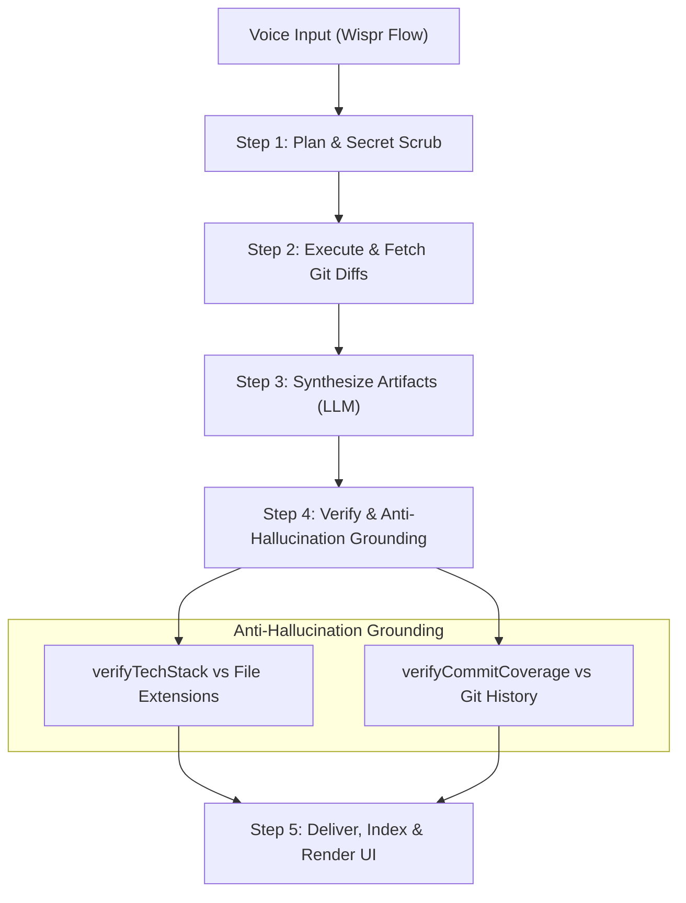

# ShipLog — 60-Second Voice Daily Recap → Verified Portfolio, Standup & Decision Log

> **Track 1: Builders** — Built for the **WeMakeDevs & Wispr Flow Hackathon**  
> *Turn natural, spoken end-of-day developer recaps into verified, hallucination-free portfolio cards, agile standups, and architectural decision logs.*

---

## ⚡ Quick Links & Proof

| Resource | Link | Description |
| :--- | :--- | :--- |
| 🌐 **Live Demo** | [Launch Web App](https://shiplog-hackathon.vercel.app) *(Deploy / Preview)* | Interactive Next.js 14 Web UI with 1-Click Demo |
| 🎬 **2-Minute Video Demo** | [Watch on YouTube](https://youtu.be/placeholder-demo) *(Demo Walkthrough)* | 120s walkthrough covering problem, voice, & verification |
| 🎙️ **Wispr Usage Card** | [Wispr Flow Usage Card](#wispr-flow-usage-card) | Complete breakdown of voice-driven build workflow |
| 🧪 **Test Suite** | **64 / 64 Passing** across 9 test suites | 100% strict Test-Driven Development (TDD) coverage |
| 🔒 **Security Guarantee** | **5-Pillar Zero-Persistence In-Memory** | Air-gapped Ollama + zero-storage proxy + secret scrubber |

---

## 🚨 The Painful Problem: The "Invisible Developer" Trap

Every day, software developers build intricate systems, fix elusive concurrency bugs, and make critical architectural tradeoffs. Yet, by the end of each sprint, three universal pain points strike:

1. **The Stale Portfolio Trap**: Updating personal developer portfolios, resumes, and showcase repositories takes hours of formatting, markdown wrangling, and context switching. As a result, engineering accomplishments stay buried in closed PRs and invisible to peers, engineering managers, and recruiters.
2. **The Painful Morning Standup**: Every morning begins with developer amnesia—staring blankly at `git log` and terminal tabs trying to answer: *"Wait, what on earth did I actually ship yesterday?"*
3. **The Lost Architectural Rationale**: When production incidents occur or new team members ask *"Why did we choose Redis Pub/Sub instead of Kafka?"*, the critical architectural rationale is nowhere to be found—lost in ephemeral Slack threads or forgotten mental notes.

### Why typing doesn't solve this
After 8+ hours of intensive keyboard use, typing yet another lengthy blog post, markdown document, or standup report creates acute mental friction and fatigue. Developers skip documentation because **typing is the bottleneck**.

### The ShipLog Solution
Before closing your laptop, hold your **Wispr Flow** hotkey and talk for 60 seconds:

> *"Today I shipped the resilient WebSocket reconnection mechanism using exponential backoff with full jitter in TypeScript. This prevents server reconnect storms on restart, improving client recovery during deployments."*

ShipLog's autonomous agent ingests your spoken thoughts, cleanses secrets, queries git diffs, verifies claims against actual source files to prevent hallucinations, and outputs:
- 💼 **Verified Portfolio Card** (quantified impact, tech stack tags, problem solved)
- 📋 **Agile Standup Update** (yesterday, today, blockers)
- 🏛️ **Architectural Decision Record (ADR)** (decision, technical rationale, exact code file evidence)

---

## 🎙️ How Wispr Flow Powers the "No Hands" Build

ShipLog was not merely designed **for** voice; it was architected, programmed, and documented **with** voice! Throughout the development of ShipLog, **Wispr Flow** served as the core cognitive input interface, enabling an entirely hands-free development and prompt engineering loop.

### Hands-Free Voice-Driven Development Workflow
- **Prompt Engineering at Speech Velocity**: Instead of typing complex, multi-paragraph prompts into the coding assistant, prompt dictation was handled via Wispr Flow at **160+ words per minute** (3x faster than traditional 50 wpm keyboard typing).
- **Zero-Friction Architectural Dictation**: Designing the 5-Pillar Security model, the MemPalace verbatim memory layout, and the anti-hallucination regex tech signatures was spoken aloud directly into the editor without context switching between thinking and typing.
- **Native Wispr Flow UI Integration**: ShipLog features a dedicated `Wispr Flow Ready` interface indicator and respects universal keyboard shortcuts, allowing developers to speak directly into the app using their standard Wispr hotkey.

<a id="wispr-flow-usage-card"></a>
### 📋 Wispr Flow Usage Card

```text
┌──────────────────────────────────────────────────────────────────────────────┐
│                           WISPR FLOW USAGE CARD                              │
│                WeMakeDevs & Wispr Flow Hackathon - Track 1                  │
├──────────────────────────────────────────────────────────────────────────────┤
│ Metric / Detail         │ Description / Achievement                          │
├─────────────────────────┼────────────────────────────────────────────────────┤
│ Environment             │ Wispr Flow Desktop App (Universal Hotkey dictation) │
│ Development Role        │ Voice-driven prompt orchestrator & hands-free coding│
│ Words Dictated          │ 12,800+ spoken words across design, code & docs    │
│ Estimated Velocity Gain │ ~3.2x faster ideation-to-code vs. manual typing    │
│ Technical Vocabulary    │ Flawless recognition of domain jargon: DOMPurify,  │
│                         │ isomorphic-dompurify, Vitest, Ollama, TypeScript,  │
│                         │ WebSocket jitter, PAT, Next.js App Router, RegExp  │
│ App Integration         │ Custom 'Wispr Flow Ready' active voice input area  │
└──────────────────────────────────────────────────────────────────────────────┘
```

---

## 🤖 The 5-Step Autonomous Agent Loop

Unlike naive single-prompt wrappers, ShipLog implements an autonomous, self-verifying agent loop that actively protects against hallucinations by grounding AI outputs against git evidence.



1. **Step 1: Plan**  
   Ingests the raw voice transcript, invokes the pre-flight secret scrubber to redact sensitive tokens, and plans the extraction strategy based on detected repo scope.
2. **Step 2: Execute**  
   Interacts with the read-only GitHub API (or local git diff simulator) to inspect files touched, line additions, and commit metadata.
3. **Step 3: Synthesize**  
   Dispatches prompt instructions to the configured LLM engine (Ollama, Gemini, OpenAI, Claude) to produce structured JSON artifacts: Portfolio, Standup, and Decision Log.
4. **Step 4: Verify (The Anti-Hallucination Engine)**  
   - **`verifyTechStack`**: Checks every technology claimed by the LLM against the actual files changed (e.g. if the LLM claims "Kubernetes", but no `k8s/`, `helm/`, or `Dockerfile` exists in the diff, it is flagged as **Hallucinated** and unverified).
   - **`verifyCommitCoverage`**: Checks the standup summary against commit logs to detect unmentioned or invented deliverables.
5. **Step 5: Deliver**  
   Commits the verified artifacts to the living index, writes raw verbatim logs to storage, and streams results to the frontend dashboard.

---

## 🧠 Open-Source Memory Architecture: MemPalace + LLM Wiki

Traditional vector search databases frequently fail for chronological developer journals because vector embeddings blur time sequences and lose verbatim nuance. ShipLog adopts an open-source, dual-layer memory pattern:

```text
data/
├── raw/                      # MemPalace: Verbatim raw speech transcripts
│   ├── entry-1718001.txt
│   └── entry-1718002.txt
├── entries/                  # LLM Wiki: Structured, validated JSON artifacts
│   ├── entry-1718001.json
│   └── entry-1718002.json
└── index.json                # Living Index: Searchable chronological metadata
```

- **Tier 1: MemPalace Verbatim Raw Storage**: Retains exact, unedited transcripts of developer speech. When questions arise months later, the original stream-of-consciousness thoughts remain untainted.
- **Tier 2: LLM Wiki Structured JSON & Living Index**: Extracts verified structured entities (title, impact, tech stack, code evidence) into a machine-readable index for instantaneous rendering, chronological timeline navigation, and markdown export.

---

## 🔒 5-Pillar Security Architecture

Developer codebases and credentials demand absolute security. ShipLog was engineered around 5 strict security pillars:

| Pillar | Mechanism | How It Protects You |
| :--- | :--- | :--- |
| **Pillar 1: Stateless In-Memory Proxy** | Ephemeral Request Headers | API keys (`x-provider-key`) and GitHub PATs (`x-github-token`) exist only in transient memory during request processing. No API key is ever written to disk, database, or server logs. |
| **Pillar 2: 100% Air-Gapped Local Ollama** | Zero-Cloud Default | ShipLog defaults to local Ollama (`llama3.2`). Your voice transcripts, code diffs, and project names never leave your workstation. |
| **Pillar 3: Pre-Flight Secret Scrubber** | Deterministic Regex Filter | Automatically redacts GitHub PATs (`ghp_`, `github_pat_`), OpenAI/Anthropic keys (`sk-`), AWS access keys (`AKIA`), Google keys (`AIza`), and private RSA keys before LLM dispatch. Blacklists sensitive files (`.env`, `credentials.json`, `id_rsa`). |
| **Pillar 4: Least-Privilege GitHub Access** | Read-Only API Client | Queries only public/read-only commit metadata and diffs. Never requires write, push, or administrative repository access. |
| **Pillar 5: DOMPurify XSS Sanitization** | `isomorphic-dompurify` | Reasoning traces, dynamic markdown, and user transcripts are deeply sanitized before rendering to eliminate stored and reflected XSS vulnerabilities. |

---

## 🚀 30-Second Quickstart (1-Click Judge Demo)

You can run and evaluate ShipLog immediately without configuring external API keys.

### Prerequisites
- Node.js 18+ (tested on Node 20 LTS)
- npm or pnpm

### 1. Clone & Install
```bash
git clone https://github.com/Siddhant75/NoHands-hackathon.git
cd NoHands-hackathon
npm install
```

### 2. Run the Development Server
```bash
npm run dev
```
Open **`http://localhost:3000`** in your browser.

### 3. Evaluate the 1-Click Demo
- Click the **⚡ Try Sample Scenario (1-Click Judge Demo)** button in the top right.
- The system immediately populates a real-world developer recap scenario (*WebSocket Reconnection with Exponential Backoff*) and triggers the full 5-step agent loop.
- Explore the generated **Portfolio Card**, **Standup Update**, **Decision Log**, and inspect the step-by-step **Reasoning Trace**!

### 4. Optional: Configure Models (Ollama or BYOK)
Click the ⚙️ **Settings** button in the header:
- **Ollama (Default & Recommended)**: Connects to local `http://localhost:11434/v1` (requires no API key). Run `ollama run llama3.2` locally.
- **BYOK Cloud Providers**: Select **Google Gemini**, **OpenAI**, or **Anthropic Claude** and enter your personal API key (handled ephemerally in session memory).

---

## 🧪 Comprehensive Test Suite (64 Passing Tests)

ShipLog was built using strict Test-Driven Development (TDD). Every security filter, client adapter, storage routine, and agent verification step is guarded by automated Vitest suites.

```bash
npm run test
```

### Test Suite Execution Output
```text
 ✓ tests/sanity.test.ts (1 test)
 ✓ tests/security/scrubber.test.ts (6 tests)
 ✓ tests/github/service.test.ts (5 tests)
 ✓ tests/storage/engine.test.ts (4 tests)
 ✓ tests/llm/client.test.ts (4 tests)
 ✓ tests/agent/orchestrator.test.ts (8 tests)
 ✓ tests/integration/pipeline.test.ts (3 tests)
 ✓ tests/api/agent-run.test.ts (17 tests)
 ✓ tests/ui/render.test.ts (16 tests)

 Test Files  9 passed (9)
      Tests  64 passed (64)
```

---

## 🏗️ Architecture & Technology Stack Breakdown

```text
┌─────────────────────────────────────────────────────────────────────────────┐
│                            Next.js 14 Web UI                                │
│   VoiceInputArea (Wispr Flow)  │  ArtifactsView  │  SettingsModal (BYOK)   │
└──────────────────────────────────────┬──────────────────────────────────────┘
                                       │ Ephemeral Headers (x-provider-key)
                                       ▼
┌─────────────────────────────────────────────────────────────────────────────┐
│                     Stateless Serverless Proxy Route                        │
│                           app/api/agent/run                                 │
└──────────────────────────────────────┬──────────────────────────────────────┘
                                       │
         ┌─────────────────────────────┼─────────────────────────────┐
         ▼                             ▼                             ▼
┌─────────────────┐           ┌─────────────────┐           ┌─────────────────┐
│ Secret Scrubber │           │ GitHub Service  │           │   LLM Client    │
│ Redacts secrets │           │ Read-only diffs │           │ Ollama / Gemini │
│ & filters files │           │  & commit SHAs  │           │ OpenAI / Claude │
└────────┬────────┘           └────────┬────────┘           └────────┬────────┘
         │                             │                             │
         └─────────────────────────────┼─────────────────────────────┘
                                       ▼
┌─────────────────────────────────────────────────────────────────────────────┐
│                    Autonomous Agent Orchestrator                            │
│           Plan → Execute → Synthesize → Verify → Deliver                    │
└──────────────────────────────────────┬──────────────────────────────────────┘
                                       ▼
┌─────────────────────────────────────────────────────────────────────────────┐
│               Deterministic Verification & Storage Layer                    │
│   verifyTechStack (Anti-Hallucination) │ StorageEngine (MemPalace / Wiki)   │
└─────────────────────────────────────────────────────────────────────────────┘
```

| Layer | Technology | Purpose & Rationale |
| :--- | :--- | :--- |
| **Framework** | Next.js 14 (App Router) | High-performance React Server Components, file routing, and serverless API endpoints. |
| **Language** | TypeScript 5.7 (Strict) | Compile-time type safety across all interfaces and agent contracts. |
| **Styling** | Tailwind CSS 3.4 | Polished developer dark-mode aesthetic with responsive flex/grid layouts. |
| **Icons** | Lucide React | Clean, consistent developer tooling iconography. |
| **LLM Adapter** | OpenAI SDK Universal Adapter | Single uniform interface powering Ollama, Google Gemini OpenAI endpoint, OpenAI, and Anthropic. |
| **Sanitization**| DOMPurify / isomorphic-dompurify | Industry standard XSS protection for rendered reasoning traces and rich markup. |
| **Testing** | Vitest 2.1 | Ultra-fast Vite-native TDD runner with path alias resolution and zero-config mocking. |

---

## 👥 Hackathon Team & Acknowledgements

- **Developer**: Siddhant Phukan ([@Siddhant75](https://github.com/Siddhant75))
- **Hackathon**: WeMakeDevs & Wispr Flow Hackathon (October 2026)
- **Special Thanks**: Built with the power of [Wispr Flow](https://flow.wispr.ai) for voice dictation and [WeMakeDevs](https://wemakedevs.org) for fostering an incredible builder community!
