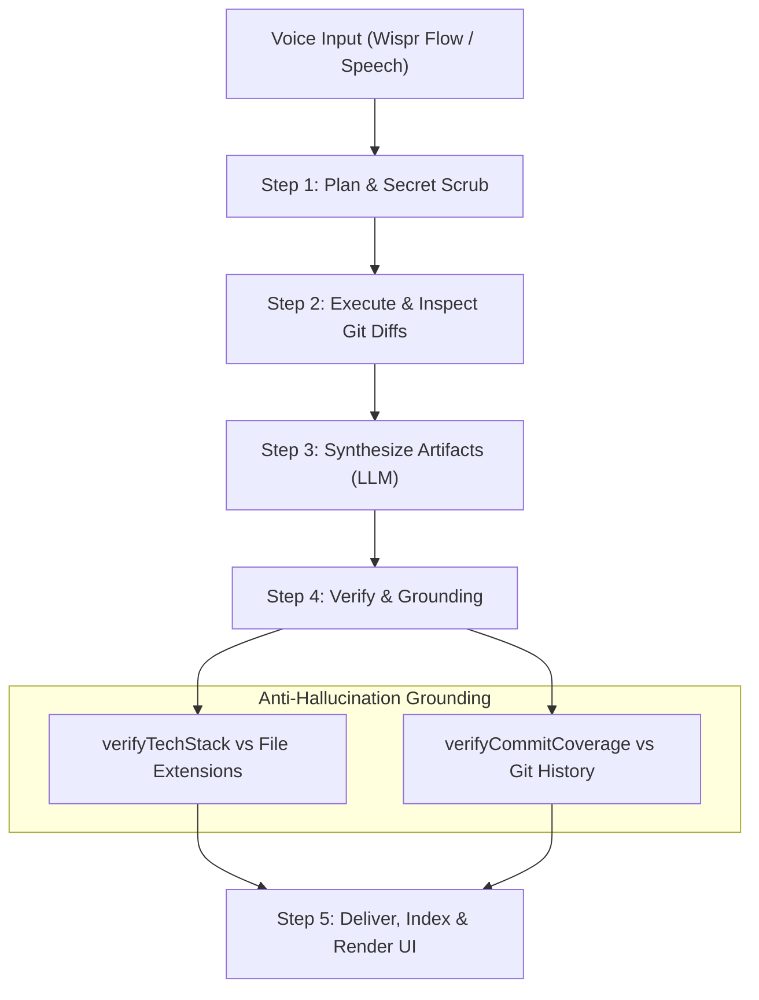

# ShipLog

> **60-Second Voice Daily Recap → Verified Portfolio Card, Agile Standup & Architectural Decision Log**

[](LICENSE)
[](https://nextjs.org/)
[](https://www.typescriptlang.org/)
[](https://vitest.dev/)
[](https://github.com/Siddhant75/NoHands-hackathon#5-pillar-security-architecture)
[](https://ollama.com/)

ShipLog is an open-source, privacy-first developer companion that transforms a 60-second spoken end-of-day recap into structured, verified engineering deliverables: **portfolio cards**, **agile standup updates**, and **architectural decision records (ADRs)**.

Unlike naive LLM wrappers, ShipLog grounds every generated claim against actual git diffs and commit histories to actively eliminate hallucinations, stores transcripts verbatim using an open-source memory architecture, and operates under a zero-persistence security model.

*Built for **Track 1: Builders** in the WeMakeDevs & Wispr Flow Hackathon, designed and engineered hands-free using voice dictation via Wispr Flow.*

---

## ⚡ Key Highlights

- 🎙️ **Voice-First Input**: Optimized for rapid end-of-day voice dictation (via [Wispr Flow](https://flow.wispr.ai) or keyboard entry). Hold your hotkey and talk through what you shipped.
- 🛡️ **Anti-Hallucination Grounding**: Autonomously inspects git diffs and commit logs. If an LLM hallucinates an unreferenced framework or invented task, ShipLog flags it with visual verification badges.
- 🔒 **5-Pillar Zero-Persistence Security**: Stateless in-memory proxy architecture ensures credentials and API keys are never written to disk, database, or server logs. Pre-flight secret scrubber strips tokens before model ingestion.
- 🧠 **Dual-Tier Memory Architecture**: Combines **MemPalace** verbatim speech transcript storage with an **LLM Wiki** structured derived JSON layer and living chronological catalog.
- 🔌 **Universal Model Support**: 100% air-gapped local inference via **Ollama** (`llama3.2`) out of the box, with Bring-Your-Own-Key (BYOK) support for **Google Gemini**, **OpenAI**, and **Anthropic Claude**.
- ⚡ **1-Click Judge & Developer Demo**: Instant evaluation mode with pre-loaded realistic scenarios (*Resilient WebSocket Reconnection Layer*) requiring zero external API keys.

---

## 🚨 The Problem: Documentation Debt & The Typing Bottleneck

Every sprint, software engineers solve complex concurrency bugs, build resilient pipelines, and make foundational architectural decisions. Yet, documentation consistently fails:

1. **The Stale Portfolio Trap**: Updating personal developer portfolios, resumes, and showcase repositories takes hours of markdown wrangling. Real engineering achievements stay buried in closed PRs.
2. **The Morning Standup Friction**: Every morning begins with developer amnesia—staring blankly at `git log` and terminal tabs trying to reconstruct: *"What did I actually finish yesterday?"*
3. **The Lost Architectural Rationale**: When production incidents arise or teammates ask *"Why did we choose Redis Pub/Sub over Kafka?"*, the rationale is lost in ephemeral chat threads or forgotten mental notes.

### Why typing fails
After 8+ hours of intensive keyboard use, typing yet another lengthy blog post, markdown document, or standup report creates acute cognitive friction. **Typing is the bottleneck.**

### The ShipLog Solution
Before closing your laptop, speak for 60 seconds into your microphone:

> *"Today I shipped the resilient WebSocket reconnection mechanism using exponential backoff with full jitter in TypeScript. This prevents server reconnect storms on restart, improving client recovery during deployments."*

ShipLog's autonomous agent ingests the audio transcript, redacts secrets, inspects git diffs, verifies tech claims against touched files, and produces three structured, verified outputs:

| Output | Description |
| :--- | :--- |
| 💼 **Portfolio Card** | Quantified impact, verified tech tags, and core challenges solved for resumes & portfolios. |
| 📋 **Standup Update** | Clean Yesterday / Today / Blockers breakdown cross-referenced with commit history. |
| 🏛️ **Decision Record (ADR)** | The architectural decision, technical rationale, and linked code file evidence. |

---

## 🤖 Autonomous 5-Step Agent Loop

ShipLog implements an autonomous, self-verifying agent pipeline that cross-references speech with code evidence to prevent hallucinations:



1. **Step 1: Plan & Scrub**  
   Ingests the raw transcript, runs the pre-flight deterministic secret scrubber to mask tokens, and detects repository scope.
2. **Step 2: Execute & Fetch Diffs**  
   Reads git commit metadata and file diffs through the read-only GitHub client (or local diff simulator).
3. **Step 3: Synthesize Artifacts**  
   Prompts the configured LLM engine (Ollama, Gemini, OpenAI, Claude) to extract structured JSON artifacts: Portfolio, Standup, and Decision Log.
4. **Step 4: Verify (Anti-Hallucination Engine)**  
   - **`verifyTechStack`**: Validates every claimed technology against actual source file extensions and imports. Unreferenced tech is flagged as unverified.
   - **`verifyCommitCoverage`**: Checks the standup summary against commit logs to detect unmentioned or invented deliverables.
5. **Step 5: Deliver & Index**  
   Stores verbatim raw transcripts, updates the living chronological catalog, and renders interactive cards in the UI.

---

## 🔒 5-Pillar Security Architecture

Developer codebases and credentials demand uncompromising security:

| Pillar | Mechanism | Protection |
| :--- | :--- | :--- |
| **Pillar 1: Stateless In-Memory Proxy** | Ephemeral Request Headers | API keys (`x-provider-key`) and GitHub PATs (`x-github-token`) exist only in transient memory during request execution. No keys are written to disk, database, or logs. |
| **Pillar 2: 100% Air-Gapped Local Ollama** | Zero-Cloud Default | Defaults to local Ollama (`llama3.2`). Transcripts, diffs, and project names never leave your local machine. |
| **Pillar 3: Pre-Flight Secret Scrubber** | Deterministic Regex Filter | Redacts GitHub PATs (`ghp_`, `github_pat_`), OpenAI/Anthropic keys (`sk-`), AWS keys (`AKIA`), Google keys (`AIza`), and private RSA/PEM keys prior to model dispatch. Sensitive files (`.env`, `credentials.json`, `id_rsa`) are blacklisted. |
| **Pillar 4: Least-Privilege GitHub Access** | Read-Only API Client | Queries only public or read-only commit metadata and file patches. Never requests write, push, or administrative repository scopes. |
| **Pillar 5: DOMPurify XSS Sanitization** | `isomorphic-dompurify` | Reasoning traces, dynamic markdown, and user transcripts are sanitized before rendering to eliminate stored and reflected XSS vectors. |

---

## 🧠 Memory Architecture: MemPalace + LLM Wiki

Traditional vector embeddings frequently fail for chronological developer logs because embeddings blur chronological sequences and lose verbatim nuance. ShipLog implements an open-source dual-tier persistence pattern:

```text
data/
├── raw/                      # MemPalace: Verbatim raw speech transcripts
│   ├── shiplog-1718001.txt
│   └── shiplog-1718002.txt
├── entries/                  # LLM Wiki: Structured, validated JSON artifacts
│   ├── shiplog-1718001.json
│   └── shiplog-1718002.json
└── index.json                # Living Index: Searchable chronological metadata catalog
```

- **Tier 1: MemPalace Verbatim Raw Storage**: Retains exact, unedited transcripts of developer speech in `data/raw/`. When questions arise months later, the original stream-of-consciousness context remains untainted.
- **Tier 2: LLM Wiki Structured JSON & Living Index**: Extracts verified structured entities (title, impact, tech stack, code evidence) into `data/entries/` and a central `data/index.json` catalog for instantaneous rendering, chronological timeline navigation, and keyword searches.

---

## 🚀 Quickstart

### Prerequisites
- [Node.js](https://nodejs.org/) 18+ (tested on Node 20 LTS)
- npm or pnpm

### 1. Clone & Install
```bash
git clone https://github.com/Siddhant75/NoHands-hackathon.git
cd NoHands-hackathon
npm install
```

### 2. Run Development Server
```bash
npm run dev
```
Open [http://localhost:3000](http://localhost:3000) in your browser.

### 3. Evaluate the 1-Click Demo
- Click **⚡ Try Sample Scenario (1-Click Judge Demo)** in the top right.
- The system loads a realistic developer debrief (*WebSocket Reconnection Layer with Exponential Backoff*) and triggers the 5-step agent loop.
- Explore the **Portfolio Card**, **Standup Update**, **Decision Log**, and step-by-step **Reasoning Trace**.

### 4. Model Configuration (Local Ollama or Cloud BYOK)
Click ⚙️ **Settings** in the dashboard header:
- **Ollama (Default & Recommended)**: Connects to local `http://localhost:11434/v1` (requires no API key). Make sure Ollama is running (`ollama run llama3.2`).
- **BYOK Cloud Providers**: Select **Google Gemini**, **OpenAI**, or **Anthropic Claude** and enter your personal API key (handled ephemerally in session memory).
- **GitHub PAT (Optional)**: Provide a read-only GitHub Personal Access Token to cross-reference live private repositories.

---

## 🔌 API Reference

ShipLog provides a stateless serverless execution endpoint:

### `POST /api/agent/run`

#### Request Headers (Zero-Persistence)
```http
Content-Type: application/json
x-provider-type: ollama | gemini | openai | anthropic   # Default: ollama
x-provider-key: <api-key>                                # Required for cloud providers
x-provider-url: http://localhost:11434                  # Optional custom Ollama URL
x-provider-model: llama3.2                              # Optional custom model
x-github-token: ghp_...                                 # Optional read-only PAT
```

#### Request Body
```json
{
  "voiceTranscript": "Today I shipped the resilient WebSocket reconnection mechanism...",
  "repo": "owner/repo",      // Optional: GitHub repository to inspect
  "isMockSample": false       // Optional: True for 1-click deterministic demo
}
```

#### Response (200 OK)
```json
{
  "success": true,
  "entryId": "shiplog-1730132000000",
  "artifacts": {
    "portfolio": {
      "title": "Resilient WebSocket Reconnection Layer",
      "techStack": ["WebSockets", "TypeScript", "Redis"],
      "impact": "Zero-drop live connection recovery with exponential backoff and jitter.",
      "challengeSolved": "Preventing thundering herd connection storms when backend servers restart."
    },
    "standup": {
      "yesterday": "Implemented WebSocket reconnection backoff with jitter and fixed JWT token renewal.",
      "today": "Add integration tests for reconnect logic and prepare staging release.",
      "blockers": "None."
    },
    "decisionLog": [
      {
        "decision": "Chose exponential backoff with full jitter over linear retry interval.",
        "rationale": "Avoids synchronized client retry spikes against recovering gateway pods.",
        "evidence": "lib/network/socketClient.ts:42"
      }
    ]
  },
  "reasoningTrace": [
    "Step 1 (Plan): Parsed voice transcript and identified technical intent.",
    "Step 2 (Execute): Ingested 3 changed files and scrubbed secrets.",
    "Step 3 (Synthesize): Compiled artifacts using provider LLM inference.",
    "Step 4 (Verify): Checked 3 tech tags (3 verified, 0 flagged).",
    "Step 5 (Deliver): Completed verification checks and compiled outputs."
  ],
  "verification": {
    "verifiedTech": ["WebSockets", "TypeScript", "Redis"],
    "hallucinatedTech": [],
    "commitCoverage": {
      "covered": ["feat: add websocket reconnection", "fix: jwt refresh"],
      "unmentioned": []
    }
  }
}
```

---

## 🧪 Testing

ShipLog enforces strict Test-Driven Development (TDD). Every module, client adapter, regex filter, storage routine, API route, and UI component is guarded by automated Vitest suites.

```bash
npm run test
```

### Test Suite Coverage
```text
 ✓ tests/sanity.test.ts (1 test)
 ✓ tests/security/scrubber.test.ts (6 tests)
 ✓ tests/github/service.test.ts (5 tests)
 ✓ tests/llm/client.test.ts (4 tests)
 ✓ tests/storage/engine.test.ts (4 tests)
 ✓ tests/agent/orchestrator.test.ts (8 tests)
 ✓ tests/integration/pipeline.test.ts (3 tests)
 ✓ tests/api/agent-run.test.ts (17 tests)
 ✓ tests/ui/render.test.ts (16 tests)

 Test Files  9 passed (9)
      Tests  64 passed (64)
```

Run TypeScript compilation check:
```bash
npx tsc --noEmit
```

---

## 📁 Project Structure

```text
.
├── app/
│   ├── api/agent/run/route.ts      # Stateless zero-persistence API route
│   ├── globals.css                 # Tailwind directives & theme styles
│   ├── layout.tsx                  # Root Next.js layout
│   └── page.tsx                    # Main interactive developer dashboard
├── components/
│   ├── ArtifactsView.tsx           # Tabbed artifacts viewer with DOMPurify sanitization
│   ├── SampleDataButton.tsx        # 1-Click judge evaluation trigger
│   ├── SettingsModal.tsx           # Session-only credential & model settings modal
│   └── VoiceInputArea.tsx          # Wispr Flow speech input area with keyboard shortcuts
├── lib/
│   ├── agent/orchestrator.ts       # 5-step autonomous agent loop with anti-hallucination
│   ├── github/service.ts           # Read-only GitHub API service with commit diffs
│   ├── llm/client.ts               # Universal LLM client factory (Ollama, Gemini, OpenAI, Claude)
│   ├── security/scrubber.ts        # Pre-flight secret scrubber & sensitive file filter
│   └── storage/engine.ts           # MemPalace + LLM Wiki local storage engine
├── tests/
│   ├── agent/orchestrator.test.ts  # Agent orchestrator & verification tests
│   ├── api/agent-run.test.ts       # API route endpoint tests (17 cases)
│   ├── github/service.test.ts      # GitHub API client unit tests
│   ├── integration/pipeline.test.ts# End-to-end integration & conformance tests
│   ├── llm/client.test.ts          # Provider client factory unit tests
│   ├── sanity.test.ts              # Tooling & environment sanity test
│   ├── security/scrubber.test.ts   # Secret scrubbing & sensitive file tests
│   ├── storage/engine.test.ts      # Storage engine, path traversal & index tests
│   └── ui/render.test.ts           # DOMPurify & UI contract render tests (16 cases)
├── docs/plans/                     # Architectural design plans
├── vitest.config.ts                # Vitest configuration with path aliases
├── tailwind.config.js              # Tailwind styling configuration
└── tsconfig.json                   # Strict TypeScript compiler configuration
```

---

## 🛠️ Technology Stack

| Component | Technology | Rationale |
| :--- | :--- | :--- |
| **Framework** | Next.js 14 (App Router) | High-performance React Server Components and serverless API endpoints. |
| **Language** | TypeScript 5.7 (Strict) | End-to-end static type safety across data contracts and agent schemas. |
| **Styling** | Tailwind CSS 3.4 | Modern, responsive dark-mode developer interface. |
| **Icons** | Lucide React | Lightweight, accessible iconography. |
| **LLM Adapter** | OpenAI SDK | Universal OpenAI-compatible interface adapter for Ollama, Gemini, OpenAI, and Claude. |
| **Sanitization** | isomorphic-dompurify | Comprehensive client and server-side XSS prevention for user & agent outputs. |
| **Testing** | Vitest 2.1 | Fast Vite-native unit and integration test runner with path alias support. |

---

## 🤝 Contributing

Contributions, feedback, and issue reports are welcome!

1. Fork the repository
2. Create your feature branch (`git checkout -b feat/amazing-feature`)
3. Commit your changes (`git commit -m 'feat: Add amazing feature'`)
4. Ensure all tests pass (`npm run test && npx tsc --noEmit`)
5. Push to the branch (`git push origin feat/amazing-feature`)
6. Open a Pull Request

---

## 📄 License

Distributed under the **MIT License**. See `LICENSE` for details.

---

## 💡 Acknowledgements

- **Hackathon**: Developed for the **WeMakeDevs & Wispr Flow Hackathon** (Track 1: Builders).
- Built with voice-driven development powered by [Wispr Flow](https://flow.wispr.ai).
- Special thanks to the [WeMakeDevs](https://wemakedevs.org) community.
