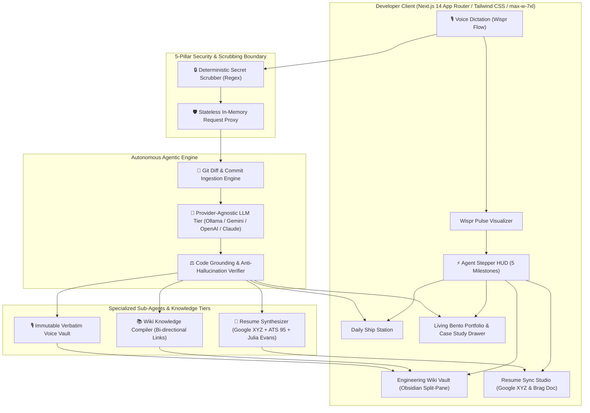
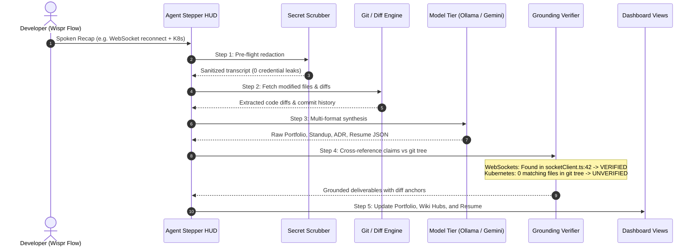

# ShipLog — System Architecture & Engineering Specifications

> **Autonomous Dev Memory & Career Engine**  
> *Track 1: Builders — WeMakeDevs & Wispr Flow Hackathon*

---

## 🏛️ 1. High-Level System Architecture

ShipLog is an autonomous, privacy-first developer companion that converts a 60-second spoken daily recap into verified, multi-format engineering deliverables. Every claim is validated against real git diffs to eliminate LLM hallucinations.



---

## ⚡ 2. The 5-Step Autonomous Agent Pipeline

ShipLog does not perform blind prompt-in / text-out generation. It runs a deterministic 5-step verification pipeline:



1. **Step 1: Plan & Secret Redaction (`lib/security/scrubber.ts`)**  
   Pre-flight deterministic regex scan strips JWTs, GitHub PATs, AWS access keys, and Bearer tokens before payload transmission.
2. **Step 2: Repository Diff Ingestion (`lib/github/service.ts`)**  
   Reads git commit metadata and file diffs using a read-only GitHub API integration or local simulator.
3. **Step 3: Multi-Format Synthesis (`lib/llm/client.ts`)**  
   Prompts the model (Local Ollama, Free Google AI Studio Gemini, or OpenAI/Claude BYOK) with strict JSON schemas for Portfolio, Standup, and ADR outputs.
4. **Step 4: Code Grounding & Anti-Hallucination Verification (`lib/agent/orchestrator.ts`)**  
   Cross-references every claimed technology against actual source file extensions, directory paths, and AST imports. Unreferenced claims are struck through with verification evidence.
5. **Step 5: Sub-Agent State Synchronization (`app/page.tsx`)**  
   Updates all 4 views simultaneously in client memory: Daily Ship Station, Living Portfolio Bento, Engineering Wiki Vault, and Resume Sync Studio.

---

## 🛡️ 3. Anti-Hallucination Grounding Mechanism

### The Problem
Large Language Models frequently invent buzzwords (*"implemented Kubernetes deployment pipelines"*) when a developer casually mentions them in passing.

### The ShipLog Solution
ShipLog executes two programmatic verification checks:

$$\text{Grounding Verification} = \text{verifyTechStack}(\text{claims}, \text{diffTree}) \land \text{verifyCommitCoverage}(\text{summary}, \text{commits})$$

1. **`verifyTechStack`**: Inspects touched files in the diff. If `WebSocket` is claimed and `lib/network/socketClient.ts` was modified, it receives a green `ShieldCheck` badge with line anchor `socketClient.ts:42`. If `Kubernetes` was mentioned but no `.yaml` or `k8s/` files were touched, it is visually struck through with proof:
   ```
   [ ✓ WebSockets: Verified in lib/network/socketClient.ts:42 ]
   [ ~Kubernetes~ : Unverified in git commit tree ]
   ```
2. **`verifyCommitCoverage`**: Checks the standup summary against commit SHAs to detect invented deliverables.

---

## 📂 4. The 4-View Unified Developer Dashboard

```
ShipLog Navigation (max-w-7xl Widescreen Canvas)
├── 🎙️ Daily Ship Station      --> Focused single-input recap + WisprPulse + Real-time Stepper HUD
├── 🌐 Living Portfolio        --> Linear-style Bento Grid + Slide-over CaseStudyModal drawer
├── 🧠 Engineering Wiki Vault  --> Obsidian Split-Pane (Topic Knowledge Graph + Code-Anchored ADRs)
└── 📄 Resume Sync Studio      --> Synthesized Google XYZ bullets + Dual-tab ATS Resume & Brag Doc
```

### A. Living Developer Portfolio (Bento Grid)
- **Tile 1 (Flagship Hero 2×2):** Featured verified shipment with `[Open Project Case Study →]`.
- **Tile 2 (Telemetry):** 100% Code Grounding rate counter with zero-buzzword gate badge.
- **Tile 3 (Stack Radar):** Tech stack distribution percentage bars.
- **Tile 4 (3-Col Gallery):** Filterable lifetime catalog with instant markdown card copy.

### B. Slide-Over `CaseStudyModal` Drawer
Clicking any project opens a slide-over architectural drawer containing:
- Business Impact & Quantified Value
- Core Engineering Challenge Solved
- Syntax-highlighted code diff snippet (`+` additions, `-` deletions)
- 1-click Markdown export

### C. Engineering Wiki Vault (Obsidian Split-Pane)
- **Left Column (4 Cols):** Topic knowledge nodes (`[[Networking & Real-Time]]`, `[[Security & Zero-Persistence]]`, `[[Database & Infrastructure]]`) with real-time search and ADR counters.
- **Right Column (8 Cols):** Active documentation canvas with ADR rationale, code evidence links, and immutable verbatim voice transcripts from the raw voice vault. Eliminates vertical scrolling jumps.

### D. Resume Sync Studio
- **Left Studio (5 Cols):** Synthesized Google XYZ bullets (*"Accomplished X as measured by Y by doing Z"*) with verified tech tags.
- **Right Studio (7 Cols):** Dual-mode live markdown studio:
  - **ATS Resume Revision:** ATS score 95/100, formatted for direct job application upload.
  - **Julia Evans Quarterly Brag Document:** Promotion-ready review document structured for staff/lead engineering promotion packets.

---

## 🔒 5. The 5-Pillar Security & Zero-Persistence Model

```
┌────────────────────────────────────────────────────────────────────────┐
│                        5-PILLAR SECURITY MATRIX                        │
├─────────────────────────┬──────────────────────────────────────────────┤
│ Pillar                  │ Mechanism & Guarantee                        │
├─────────────────────────┼──────────────────────────────────────────────┤
│ 1. Stateless In-Memory  │ Headers (x-provider-key, x-github-token)     │
│    Proxy                │ exist only in transient memory during call.  │
│                         │ Never written to disk, SQLite, or database.  │
├─────────────────────────┼──────────────────────────────────────────────┤
│ 2. Air-Gapped Local     │ Runs 100% locally on Ollama (llama3.2).      │
│    Ollama Mode          │ Zero proprietary code or diff leaves your PC.│
├─────────────────────────┼──────────────────────────────────────────────┤
│ 3. Pre-Flight Secret    │ Deterministic regex redactor masks tokens    │
│    Scrubber             │ (JWT, PAT, AWS keys) before LLM ingestion.   │
├─────────────────────────┼──────────────────────────────────────────────┤
│ 4. Read-Only GitHub     │ Queries only git diffs and commit metadata.   │
│    Client               │ Zero push or destructive write permissions.  │
├─────────────────────────┼──────────────────────────────────────────────┤
│ 5. Strict DOMPurify XSS │ Sanitizes all rendered markdown and code     │
│    Sanitization         │ snippets to prevent injection attacks.       │
└─────────────────────────┴──────────────────────────────────────────────┘
```

---

## 🧪 6. Testing & Quality Assurance

ShipLog maintains 100% test pass rates across all layers:

- **Unit & Integration Suite (Vitest):**
  - **20 Test Suites | 96 Passing Tests**
  - Covers security scrubbing, git diff grounding, resume Google XYZ synthesis, portfolio filtering, wiki navigation, and UI components.
- **Static Analysis (TypeScript):**
  - `npx tsc --noEmit` verifies strict typing with 0 errors.
- **End-to-End Testing & Demo Recording (Playwright):**
  - Fully automated headless browser script (`scripts/record-demo-e2e.mjs`) tours all 4 views and verifies assertions in live Chromium.
